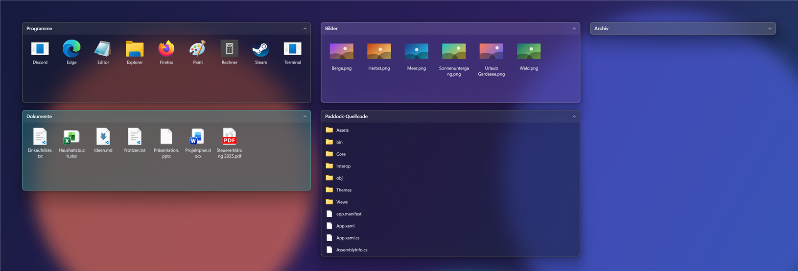
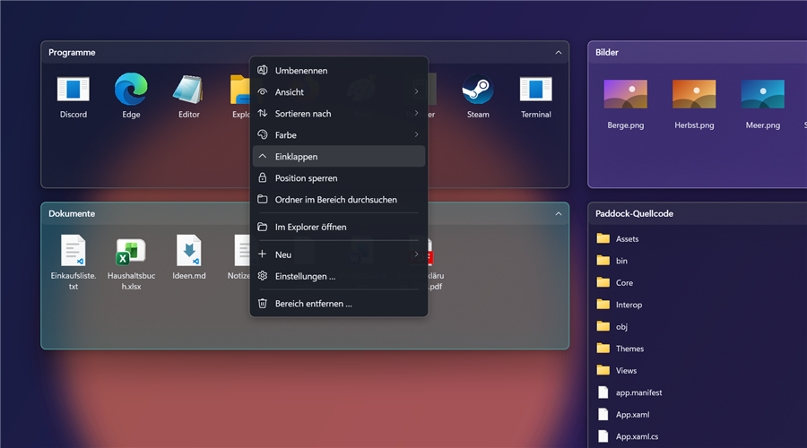
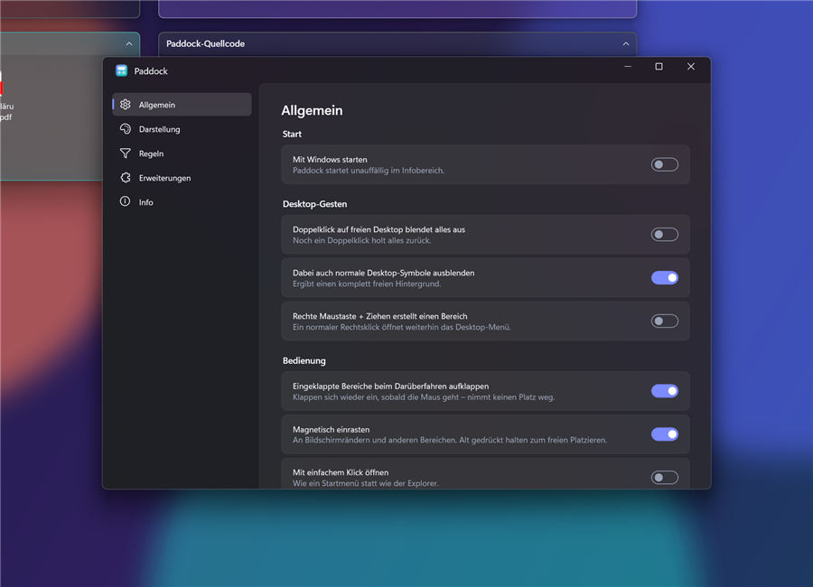

# Paddock

<!-- links:start -->
[](https://malura.de/go/kofi?ref=paddock)
[](https://malura.de/go/site?ref=paddock)
<!-- links:end -->

**Translucent, collapsible areas for your Windows desktop: tidy without getting in your way.**

Back in the Windows XP days there were desktop organizers that let you draw labelled, shaded boxes on the desktop and keep your icons in them. A double-click on the empty desktop made everything disappear. Paddock brings that idea to Windows 10 and 11. It is built from scratch, with real acrylic glass, native Explorer integration, themes and plugins.

[](LICENSE)
[](#install)
[](https://github.com/maluramichael/paddock/releases/latest)
[](https://github.com/maluramichael/paddock/actions/workflows/ci.yml)



## What it does

- **Draw areas directly on the desktop.** Hold the right mouse button and drag on an empty spot. Desktop icons underneath move straight into the new area. A plain right-click still opens the normal desktop menu.
- **Double-click the empty desktop to hide everything.** Areas and, optionally, the normal desktop icons fade out. Double-click again and they come back, so you get a clean wallpaper in one gesture.
- **Collapse areas to their title bar.** Click the title to roll an area up. Hovering a collapsed area peeks it open and it closes again when the mouse leaves.
- **Folder portals.** An area can show any existing folder, such as Downloads or a project folder, and you can browse into subfolders inside it.
- **Real Explorer behaviour.** Double-click opens, right-click shows the real Explorer context menu (*Send to*, *Open with*, 7-Zip …), and drag and drop works to and from Explorer, the desktop and other areas, including copy (Ctrl) and link (Alt). Moves can be undone with Ctrl+Z in Explorer.
- **Keyboard like on the desktop.** Click into an area and use Del / Shift+Del, F2, Enter, Ctrl+A/C/X/V, the arrow keys and F5. The area still stays below every window.
- **Rules.** New files on the desktop can be sorted into areas automatically by extension, kind, name pattern, regex or age. *Tidy up desktop* does it once for everything that is already there.
- **Magnetic snapping** to screen edges and to other areas. Hold Alt to place freely.
- **Themes and colours.** It ships with five themes (acrylic, blur and solid). Any area can get its own tint, and themes are small JSON files that reload live.
- **Plugins.** .NET plugins can add rule conditions and menu commands, see [docs/PLUGINS.md](docs/PLUGINS.md).



## Not in the way, light on resources

- Areas sit **below all normal windows**, never take focus, have no taskbar button and do not appear in Alt+Tab. They stay visible with *Show desktop* (Win+D).
- **Event-driven, no polling.** File system watchers, Windows events and a mouse hook that is only installed while a desktop gesture is enabled. Idle CPU is 0 %.
- **Blur and transparency are composed by Windows (DWM) on the GPU.** The windows are not layered, so WPF only redraws content when it changes.
- Icons load on a background thread with a small cache. After start-up Paddock hands unused memory back to Windows.
- The *Graphit* theme skips blur entirely for older machines.

## Install

Download the latest **`Paddock-x.y.z-x64.msi`** from [Releases](https://github.com/maluramichael/paddock/releases/latest) and run it. The .NET runtime is included, so there is nothing else to install. Paddock starts after setup and shows a short welcome with the three gestures.

**Updates install themselves.** On start, and once a day after that, Paddock checks GitHub for a new release, verifies the MSI's SHA-256 checksum and installs it. Windows asks once for administrator rights, then Paddock restarts. You can turn this off in Settings → *Allgemein* or check by hand under *Info* or from the tray menu.

There is also a **portable ZIP**, which only notifies you about new versions. Unpack it anywhere and create an empty `data` folder next to `Paddock.exe` to keep all settings in that folder instead of `%APPDATA%`.

Requirements: Windows 10 1903 or newer, or Windows 11 (x64). Rounded corners need Windows 11.

> The user interface is currently German.

## Where your files live

- A normal area is backed by its own folder under `%USERPROFILE%\Paddock\<Area name>`, which you can change in settings. Dragging desktop files into an area moves them there. That is what clears the desktop, and the files stay reachable through the area. Removing an area asks whether to put its files back on the desktop.
- A **folder portal** just shows an existing folder and never moves anything on its own.
- Settings are stored in `%APPDATA%\Paddock\config.json`. Themes and plugins live next to it.

## Themes



Settings → *Darstellung* → *Aktuelles Theme als Vorlage kopieren* writes a JSON copy of the current theme to `%APPDATA%\Paddock\themes`. Edit it and save, and every area updates immediately. All values are documented in [docs/THEMES.md](docs/THEMES.md). For deeper changes a theme can merge a XAML `ResourceDictionary`.

## Build from source

You need the .NET 9 SDK on Windows.

```powershell
dotnet build Paddock.sln
dotnet test tests/Paddock.Tests
dotnet run --project src/Paddock

# Full release build: tests, self-contained publish, example plugin, MSI and portable ZIP
./build/build.ps1 -Version 1.2.3
```

To try Paddock without touching your real configuration, point it at a throwaway data folder:

```powershell
$env:PADDOCK_DATA = "$env:TEMP\paddock-test"; dotnet run --project src/Paddock
```

Project layout:

| Path | Contents |
|------|----------|
| `src/Paddock` | WPF app: fences, tray, settings, shell interop |
| `src/Paddock.Sdk` | Plugin interfaces (`IPaddockPlugin`, `IRuleCondition`, …) |
| `plugins/Paddock.Plugins.Examples` | Example plugin, shipped with the installer |
| `tests/Paddock.Tests` | xUnit tests (snapping, rules, plugin) |
| `installer` | WiX 5 MSI project |
| `build` | Build and versioning scripts used locally and in CI |

## Releases and versioning

Every push to `main` builds and publishes a release automatically. The version follows `major.minor.patch` and is derived from the commit messages since the last tag:

| Commit | Bump |
|--------|------|
| `fix: …`, `chore: …`, anything else | patch |
| `feat: …` | minor |
| `feat!: …` or a `BREAKING CHANGE:` footer | major (rare) |

A maintainer can also start the *Release* workflow by hand and pick the bump. Details are in [CONTRIBUTING.md](CONTRIBUTING.md).

## Contributing

Issues and pull requests are welcome. Please read [CONTRIBUTING.md](CONTRIBUTING.md) first.

## License

[MIT with Attribution](LICENSE). You may use, modify and redistribute Paddock. If you redistribute it or a modified version, credit *"Based on Paddock by Michael Malura"* with a link to this repository. If you publish a fork, I'd love to hear about it: open an issue or mention [@maluramichael](https://github.com/maluramichael).

> Built by [Michael Malura](https://malura.de). Inspired by the desktop organizers of the Windows XP era. Paddock is an independent project and is not affiliated with any of them.
